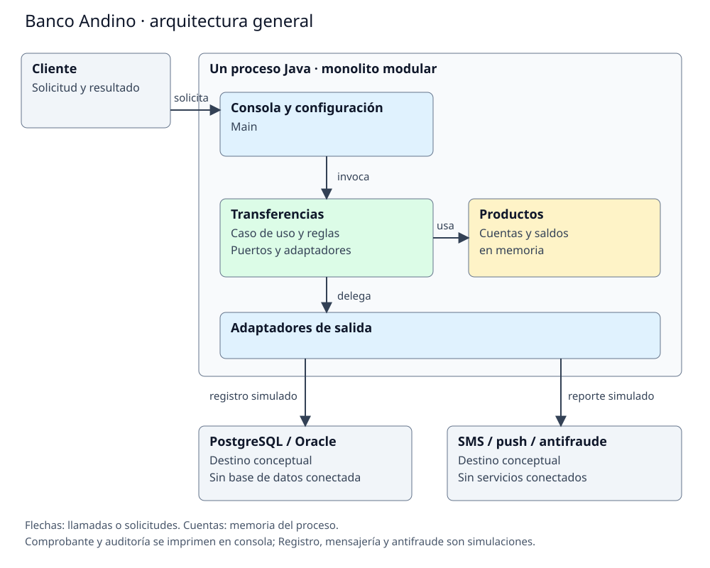

# Fase 2. Arquitectura general

## Decisión

Se adopta un monolito modular: un único proceso Java, con separación por paquetes. "Transferencias" concentra el caso de uso seleccionado. "Productos" contiene las cuentas y las clases heredadas que las acompañan. Son módulos lógicos; no son servicios desplegables ni módulos JPMS.

Las flechas representan llamadas o solicitudes. El recuadro central es un solo proceso. La consola inicia el caso de uso, transferencias opera sobre las cuentas y delega las salidas. El registro, la mensajería y el reporte antifraude se muestran fuera del proceso como destinos conceptuales; los adaptadores actuales solo escriben en consola. No hay una base de datos conectada, un gateway ni un broker.

## Componentes y almacenamiento

| Parte | Responsabilidad | Estado en el laboratorio |
|---|---|---|
| Consola y configuración | Crear cuentas, registrar comisiones y conectar las dependencias. | "Main" ejecuta un ejemplo fijo; no es una interfaz de banca para clientes. |
| Transferencias | Validar, calcular la comisión y coordinar el movimiento y sus salidas. | Caso de uso implementado, reorganizado en la fase 3. |
| Productos | Mantener cuentas y saldos; conservar los otros productos de la base. | Objetos en memoria durante la ejecución. |
| Salidas de transferencias | Traducir las llamadas hacia registro, mensajería, comprobante y auditoría. | Implementaciones de consola. |
| Registro bancario / PostgreSQL u Oracle | Almacenar operaciones fuera del proceso. | Destino previsto; "PostgresRepositorio" es la implementación seleccionada; "OracleRepositorio" se conserva como alternativa. Ambas simulan la solicitud y no persiste. |
| Proveedores SMS y push | Entregar mensajes al titular. | "SmsGateway" y "PushGateway" simulan el envío; "CanalNotificacionCompuesto" llama a ambos. |

| Sistema antifraude | Recibir el reporte de una transferencia aceptada. | "SistemaAntifraude" imprime el reporte; "AuditoriaCompuesta" lo combina con "RegistroAuditoria". |

## Comparación con microservicios

| Criterio de fase 1 | Monolito modular | Microservicios |
|---|---|---|
| AC-01: nuevas comisiones sin cambiar el coordinador | Se resuelve con políticas dentro del mismo proceso. | Separar procesos no elimina por sí mismo el acoplamiento entre clases. |
| AC-02: pruebas aisladas | El caso de uso recibe dobles mediante interfaces. | También permite dobles, pero probar la integración añade red y despliegues. |
| AC-03: cambiar proveedores sin alterar el núcleo | Los adaptadores quedan fuera de dominio y aplicación. | Puede aislar proveedores en servicios, con contratos remotos adicionales. |

No tenemos equipos con despliegues independientes ni una necesidad medida de escalar componentes por separado. Los microservicios añadirían comunicación remota, fallos parciales y consistencia distribuida sin resolver una necesidad del alcance actual. Por eso se descartan para esta versión.

La contrapartida del monolito es compartir proceso y despliegue: un fallo puede afectar al conjunto y no se escala cada módulo por separado. Las fronteras por interfaces ayudan a mantener el código, pero no garantizan disponibilidad ni atomicidad. Si aparecieran requisitos de despliegue independiente o cargas muy distintas, habría que revisar esta decisión con mediciones.
