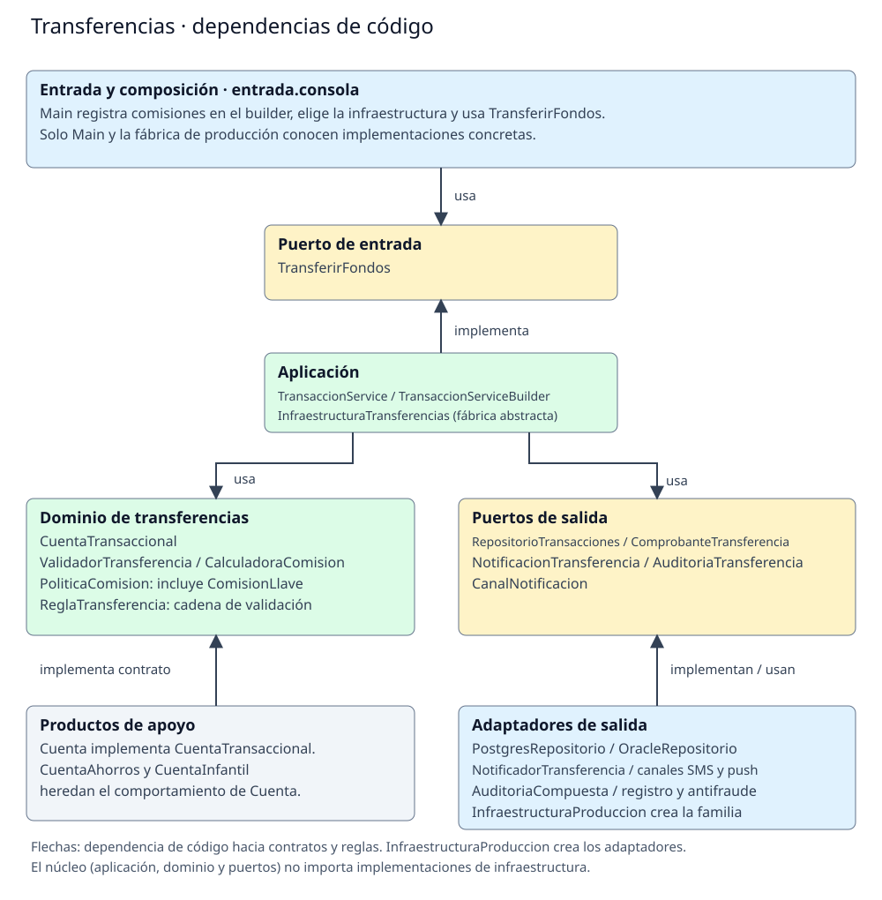

# Fase 3. Componente de transferencias

## Selección y estilo

Se selecciona transferencias porque combina reglas de negocio con varias salidas externas. Una comisión nueva y un cambio de proveedor deben afectar partes distintas del código. Se usa arquitectura hexagonal para separar el caso de uso de la consola y de las implementaciones de registro y mensajería.

Las flechas muestran dependencias de código. La aplicación conoce el dominio y los puertos. Los adaptadores dependen de los puertos que utilizan o implementan; el núcleo no importa adaptadores. La dirección de una llamada al repositorio durante la ejecución no invierte esa dependencia: el servicio usa la interfaz recibida por constructor.

## Clases y responsabilidades

Todos los paquetes cuelgan de "co.edu.unal.banco".

| Parte | Paquete | Clases e interfaces |
|---|---|---|
| Puerto de entrada | "transferencias.puertos.entrada" | "TransferirFondos": operación "transferir" con cuentas, monto y tipo. |
| Caso de uso | "transferencias.aplicacion" | "TransaccionService": implementa el puerto y coordina la operación. |
| Dominio | "transferencias.dominio" | "CuentaTransaccional", "ValidacionTransferencia", "ValidadorTransferencia", "CalculoComision", "CalculadoraComision", "PoliticaComision" y las cuatro comisiones: mismo banco, otro banco, internacional y llave. |
| Puertos de salida | "transferencias.puertos.salida" | "RepositorioTransacciones", "ComprobanteTransferencia", "NotificacionTransferencia", "AuditoriaTransferencia" y "CanalNotificacion". |
| Adaptadores de salida | "transferencias.adaptadores.salida" | "PostgresRepositorio", "OracleRepositorio", "GeneradorComprobante", "NotificadorTransferencia", "CanalNotificacionCompuesto", "SmsGateway", "PushGateway", "AuditoriaCompuesta", "RegistroAuditoria" y "SistemaAntifraude". |
| Adaptador de entrada y composición | "entrada.consola" | "Main": construye las dependencias y llama a "TransferirFondos". Conoce clases concretas para conectarlas. |
| Productos de apoyo | "productos.dominio" | "ProductoConSaldo", "Cuenta", "CuentaAhorros", "CuentaInfantil", "CDT", "ProductoBancario", "ProductoCredito", "TarjetaCredito" y "CreditoVivienda". "Cuenta" implementa "CuentaTransaccional". |
| Operaciones de apoyo | "productos.aplicacion" | "CobroCuotaManejo" y "GeneradorExtractos", conservados de la base. |

"NotificadorTransferencia" adapta la operación de notificar a una llamada al canal: prepara el texto y delega en "CanalNotificacion". "CanalNotificacionCompuesto" distribuye el mensaje a "SmsGateway" y "PushGateway". "AuditoriaCompuesta" delega en "RegistroAuditoria" y "SistemaAntifraude". Todos conservan las simulaciones existentes.

## Flujo de la operación

1. "Main" crea cuentas y colaboradores; usa el contrato "TransferirFondos".
2. "TransaccionService" valida el monto y calcula la comisión.
3. Retira monto más comisión del origen y deposita el monto en el destino.
4. Solicita registro, comprobante, notificación y auditoría, en ese orden.

Las 15 pruebas comprueban el caso de uso, las reglas de las cuentas y las salidas simuladas. Las pruebas aisladas usan repositorio y notificador en memoria. Estos dobles viven en "src/test/java"; no son almacenamiento del programa.

## Alcance del cambio

Se parte de "c7ce69a" ("bloque-6-cierre"), con llave, cuenta infantil, PostgreSQL, push y antifraude ya incorporados. Se mueven clases a "src/main/java", se declaran paquetes e importaciones y se usa la estructura estándar de Maven. Se añade únicamente el contrato de entrada "TransferirFondos" y se conecta a "TransaccionService" y "Main". Las firmas existentes, cálculos, mensajes y orden de efectos se conservan.

La aplicación sigue siendo una demostración local. La arquitectura permite sustituir dependencias, pero no añade autenticación, persistencia, reversión de movimientos ni garantías frente a fallos de los adaptadores.
