# Fase 4. SOLID

## Diagrama de clases

El diagrama muestra el componente de transferencias en su estado actual (rama "lab3") y las clases de "productos.dominio" que intervienen en él. Cada recuadro amarillo es un paquete de la arquitectura hexagonal descrita en la fase 3. Se omiten "CobroCuotaManejo", "GeneradorExtractos", "TarjetaCredito", "CreditoVivienda" y "ProductoCredito", que no participan en una transferencia; aparecen en la evidencia de L e I cuando hace falta.



Fuente: "diagramas/clases-transferencias.mmd" (Mermaid). Para que el diagrama se pueda leer, de "Main" solo se dibujan "TransferirFondos", "TransaccionServiceBuilder" e "InfraestructuraProduccion"; las cuentas y comisiones que crea se omiten. El diagrama ya incluye las clases agregadas en la fase 5 (cadena de validación, builder y fábrica de infraestructura).

Lectura rápida:

- "TransaccionService" solo tiene asociaciones hacia interfaces: cuatro puertos de salida y dos contratos del dominio.
- Cada interfaz tiene sus implementaciones debajo. Las que se agregaron después del código base (llave, PostgreSQL, push, antifraude) son hojas nuevas; no cambiaron ninguna flecha existente.
- "CDT" y "Cuenta" son hermanas bajo "ProductoConSaldo". Solo "Cuenta" implementa "CuentaTransaccional".

## Evidencia por principio

| Principio | Dónde se cumple | Evidencia en el código |
|---|---|---|
| S | "TransaccionService" | "transferir" (líneas 32–41) solo ordena los pasos. Validar, calcular la comisión, guardar, imprimir el comprobante, armar el mensaje y auditar viven cada uno en una clase distinta. Su única razón para cambiar es el orden de una transferencia. |
| S | "NotificadorTransferencia" y "SmsGateway" / "PushGateway" | El texto del mensaje está en el notificador; el envío está en cada canal. Cambiar la redacción y cambiar de proveedor tocan archivos distintos. |
| O | "PoliticaComision" y "CalculadoraComision" | Las comisiones se registran en un "Map" desde "Main". "ComisionLlave" se agregó como clase nueva sin modificar la calculadora ni el servicio (AC-01). |
| O | "CanalNotificacionCompuesto" y "AuditoriaCompuesta" | Push y antifraude se sumaron como elementos de una lista; "TransaccionService" sigue llamando una vez al notificador y una vez a la auditoría. |
| L | "ProductoConSaldo", "Cuenta", "CDT" | "CDT" ya no hereda de "Cuenta", así que no promete un retiro libre que no cumple. "CobroCuotaManejo" recibe "List<Cuenta>": un CDT en esa lista no compila. |
| L | "Cuenta.cobrarCargo" (línea 14) | Es "final": ninguna subclase, como "CuentaInfantil", puede agregarle restricciones. El cobro de la cuota funciona igual con cualquier "Cuenta". |
| I | "ProductoBancario" y "ProductoCredito" | "ProductoBancario" solo exige "generarExtracto". Intereses y cuotas están en "ProductoCredito". Ninguna clase tiene métodos vacíos por "no aplica". |
| I | Puertos de salida | Cada puerto tiene un solo método ("guardarTransaccion", "generar", "notificar", "registrar", "enviar"). Un adaptador implementa solo lo que hace. |
| D | Constructor de "TransaccionService" | Recibe seis abstracciones y no crea nada con "new". Ninguna clase de "aplicacion", "dominio" o "puertos" importa un adaptador (0 importaciones, AC-03). |
| D | "Main" e "InfraestructuraProduccion" | "Main" elige la familia de infraestructura; "InfraestructuraProduccion" es la única clase que decide si se usa PostgreSQL u Oracle, SMS o push. Las pruebas arman el mismo servicio con "RepositorioEnMemoria" y "NotificadorEnMemoria". |

## Antes y después

Los "antes" vienen del commit "951bcd0" ("bloque-0-codigo-base"). Los cinco principios tuvieron una corrección; se detallan con código S + O, L y D, y se resume I.

### S y O: el método "transferir"

Antes ("TransaccionService.java", líneas 7–42 del código base), un solo método validaba, elegía la comisión con un "switch", movía el dinero, guardaba, imprimía el comprobante, notificaba y auditaba:

```java
public void transferir(Cuenta origen, Cuenta destino, double monto, String tipo) {
    if (monto <= 0) throw new IllegalArgumentException("Monto inválido");
    if (monto > 5_000_000) throw new IllegalArgumentException("Supera el tope diario");

    double comision;
    switch (tipo) {
        case "MISMO_BANCO"   -> comision = 0;
        case "OTRO_BANCO"    -> comision = 7_500;
        case "INTERNACIONAL" -> comision = monto * 0.03 + 25_000;
        default -> throw new IllegalArgumentException("Tipo de transferencia desconocido");
    }
    origen.retirar(monto + comision);
    destino.depositar(monto);
    repositorio.guardarTransaccion(origen.getNumero(), destino.getNumero(), monto, comision);
    System.out.println("===== BANCO ANDINO - COMPROBANTE =====");
    // ... cinco líneas más de comprobante, el SMS y la auditoría
}
```

- **Violación de S:** siete razones para cambiar en la clase que mueve el dinero. Un cambio de formato del comprobante obligaba a editar la operación financiera.
- **Violación de O:** cada tipo de transferencia nuevo era un "case" más en ese método.

Después ("TransaccionService.java", líneas 32–41):

```java
public void transferir(CuentaTransaccional origen, CuentaTransaccional destino, double monto, String tipo) {
    validador.validar(origen, destino, monto);
    double comision = calculadora.calcular(monto, tipo);
    origen.retirar(monto + comision);
    destino.depositar(monto);
    repositorio.guardarTransaccion(origen.getNumero(), destino.getNumero(), monto, comision);
    comprobante.generar(origen, destino, monto, comision);
    notificador.notificar(origen, destino, monto);
    auditoria.registrar(origen, destino, monto, tipo);
}
```

El "switch" se reemplazó por "PoliticaComision", con una clase por comisión, y "CalculadoraComision" que busca la política por tipo. La transferencia por llave (R1 del laboratorio anterior) fue la prueba: una clase nueva, "ComisionLlave", y una línea en "Main". "TransaccionService.java" y "CalculadoraComision.java" no cambiaron.

### L: el CDT y la cuota de manejo

Antes, "CDT" heredaba de "Cuenta" y rechazaba el retiro que su padre prometía:

```java
public class CDT extends Cuenta {
    @Override
    public void retirar(double monto) {
        if (LocalDate.now().isBefore(vencimiento)) {
            throw new UnsupportedOperationException(
                "Un CDT no permite retiros antes del vencimiento");
        }
        super.retirar(monto);
    }
}
```

"CobroCuotaManejo" aceptaba cualquier "Cuenta" y llamaba a "retirar". Con un CDT en la lista, el lote cobraba a las cuentas anteriores y se detenía con una excepción, sin revertir nada (experimento 1 del laboratorio anterior).

Después hay dos correcciones:

1. "CDT" y "Cuenta" heredan de "ProductoConSaldo", que ofrece número, titular, saldo y depósito, pero no un retiro libre. "CobroCuotaManejo" recibe "List<Cuenta>", así que el error aparece al compilar.
2. Al agregar "CuentaInfantil" apareció el mismo problema por otro camino: su "retirar" tiene un límite diario y la cuota usaba "retirar". Se separó el cargo del banco del retiro del cliente:

```java
public class Cuenta extends ProductoConSaldo implements ProductoBancario, CuentaTransaccional {
    public void retirar(double monto) { descontarSaldo(monto); }          // las subclases pueden restringirlo
    public final void cobrarCargo(double monto) { descontarSaldo(monto); } // ninguna subclase lo cambia
}
```

"CuentaInfantilTest.laCuotaDeManejoSeCobraAunqueYaAlcanzoElLimiteDiario" comprueba que una cuenta infantil sustituye a "Cuenta" en el cobro sin romperlo.

### D: repositorio y SMS

Antes ("TransaccionService.java", líneas 4–5 del código base):

```java
private final OracleRepositorio repositorio = new OracleRepositorio();
private final SmsGateway sms = new SmsGateway();
```

El servicio de alto nivel dependía de dos detalles de infraestructura y no se podía probar sin ellos.

Después, el servicio recibe "RepositorioTransacciones" y "NotificacionTransferencia" por constructor, y "Main" elige las implementaciones. Así quedó al cerrar el laboratorio anterior:

```java
TransferirFondos servicio = new TransaccionService(
    new ValidadorTransferencia(), calculadora, new PostgresRepositorio(),
    new GeneradorComprobante(),
    new NotificadorTransferencia(new CanalNotificacionCompuesto(
        List.of(new SmsGateway(), new PushGateway()))),
    new AuditoriaCompuesta(List.of(new RegistroAuditoria(), new SistemaAntifraude()))
);
```

La migración de Oracle a PostgreSQL (R5) cambió solo esa línea de "Main". Las 15 pruebas usan "RepositorioEnMemoria" y no cambiaron. En la fase 5 esta composición pasa a "TransaccionServiceBuilder" e "InfraestructuraProduccion"; la dependencia del servicio hacia abstracciones no cambia.

### I: productos bancarios (resumen)

Antes, "ProductoBancario" exigía "depositar", "retirar", "calcularIntereses", "pagarCuota" y "generarExtracto". "TarjetaCredito.depositar", "CreditoVivienda.depositar" y "CreditoVivienda.retirar" tenían cuerpos vacíos con el comentario "no aplica": el cliente llamaba la operación y no pasaba nada. Después, "ProductoBancario" solo tiene "generarExtracto" y "ProductoCredito" agrupa intereses y cuota. Los tres métodos vacíos se eliminaron.

## Resumen de mediciones

| Métrica | Antes ("951bcd0") | Después ("lab3") |
|---|---|---|
| Razones para cambiar "TransaccionService" | 7 | 1 |
| Clases concretas que crea "TransaccionService" | 2 | 0 |
| Archivos existentes modificados para agregar un tipo de comisión | 1 ("TransaccionService.java") | 1 ("Main.java", solo el registro) |
| Métodos vacíos por "no aplica" | 3 | 0 |
| Importaciones de adaptadores desde dominio, aplicación o puertos | No aplica (no había capas) | 0 |

## Puntos débiles que quedan

El diseño no es perfecto. Estos puntos se tendrán en cuenta en la fase 5:

1. **I en el destino.** El comprobante, el notificador y la auditoría reciben "CuentaTransaccional" como destino, aunque solo usan "getNumero" y "getTitular", y "transferir" solo le deposita. Un destino que no sea una cuenta (por ejemplo, una factura) tendría que implementar un "retirar" que no aplica. La revisión cruzada del laboratorio anterior propuso una interfaz "DestinoTransferencia".
2. **S en el nombre de un puerto.** "AuditoriaTransferencia" también aloja el antifraude. Su papel real es "acción posterior a una transferencia exitosa".
3. **Abstracciones con una sola implementación.** "CalculoComision" tiene una sola implementación y las pruebas usan la real. Cumple D, pero hoy no aporta una sustitución. "ValidacionTransferencia" tenía el mismo problema; en la fase 5 pasó a ser la interfaz de una cadena de reglas.
4. **El tipo es un "String".** Un tipo mal escrito en "Main" solo se detecta al ejecutar, cuando "CalculadoraComision" no encuentra la política.
