# Fase 5. Patrones de diseño

## Resumen

| Familia | Patrón | Problema del dominio | Archivos principales |
|---|---|---|---|
| Creacional | Builder | Armar "TransaccionService" exige seis colaboradores por posición y un "Map" de comisiones. | "aplicacion/TransaccionServiceBuilder.java" |
| Creacional | Abstract Factory | Producción y pruebas usan familias de adaptadores que no se deben mezclar. | "aplicacion/InfraestructuraTransferencias.java", "adaptadores/salida/InfraestructuraProduccion.java", "src/test/.../InfraestructuraEnMemoria.java" |
| Estructural | Adapter | El caso de uso habla de transferencias; los proveedores de mensajería solo envían texto a un destinatario. | "adaptadores/salida/NotificadorTransferencia.java" |
| Estructural | Composite | Una transferencia debe llegar a varios canales y a varias auditorías sin que el servicio lo sepa. | "adaptadores/salida/CanalNotificacionCompuesto.java", "adaptadores/salida/AuditoriaCompuesta.java" |
| Comportamiento | Strategy | La comisión cambia según el tipo de transferencia. | "dominio/PoliticaComision.java", "dominio/CalculadoraComision.java", "dominio/Comision*.java" |
| Comportamiento | Chain of Responsibility | Las validaciones previas al movimiento son una secuencia que crece y cambia de orden. | "dominio/ReglaTransferencia.java", "dominio/MontoPositivo.java", "dominio/TopePorTransferencia.java", "dominio/CuentasDistintas.java" |

Las rutas son relativas a "src/main/java/co/edu/unal/banco/transferencias/". Strategy, Adapter y Composite ya estaban en el código desde el laboratorio anterior; aquí se documentan con sus roles. Builder, Abstract Factory y Chain of Responsibility se agregaron en esta fase, cada uno por un problema que se ve en el repositorio. Se descartó Singleton: no hay un recurso que deba ser único.

Todos los patrones encajan en la arquitectura hexagonal de la fase 3. Las reglas (Strategy, Chain) viven en el dominio. El Builder y la interfaz de la fábrica viven en la aplicación y solo conocen puertos. Las fábricas concretas, el Adapter y los Composite viven en los adaptadores de salida. Ninguna clase de dominio, aplicación o puertos importa un adaptador.

---

## 1. Builder (creacional)

### Problema

Al cerrar el laboratorio anterior, "Main" armaba el servicio así:

```java
CalculadoraComision calculadora = new CalculadoraComision(Map.of(
    "MISMO_BANCO", new ComisionMismoBanco(), /* ... */ "LLAVE", new ComisionLlave()));
TransferirFondos servicio = new TransaccionService(
    new ValidadorTransferencia(), calculadora, new PostgresRepositorio(),
    new GeneradorComprobante(),
    new NotificadorTransferencia(new CanalNotificacionCompuesto(List.of(new SmsGateway(), new PushGateway()))),
    new AuditoriaCompuesta(List.of(new RegistroAuditoria(), new SistemaAntifraude())));
```

El constructor recibe seis interfaces por posición. Las seis pruebas que crean el servicio repiten esa misma llamada. Además, "Map.of" no admite más de diez pares y tampoco avisa con claridad cuando se repite un tipo. Nada impide construir un servicio sin comisiones; el error solo aparece en la primera transferencia.

### Solución

"TransaccionServiceBuilder" construye el servicio paso a paso: registra las comisiones una por una ("comision(tipo, politica)"), recibe la infraestructura y, si no se indica otra cosa, usa la validación estándar del banco. "construir()" verifica que haya infraestructura y al menos una comisión antes de crear "CalculadoraComision" y "TransaccionService".

```java
TransferirFondos servicio = new TransaccionServiceBuilder()
    .comision("MISMO_BANCO", new ComisionMismoBanco())
    .comision("OTRO_BANCO", new ComisionOtroBanco())
    .comision("INTERNACIONAL", new ComisionInternacional())
    .comision("LLAVE", new ComisionLlave())
    .infraestructura(new InfraestructuraProduccion())
    .construir();
```

**Alternativa descartada:** constructores sobrecargados (telescópicos) en "TransaccionService". Cada combinación de parámetros sería un constructor más en la clase que coordina el dinero, y seguiría siendo posible confundir dos parámetros del mismo tipo.

### Participantes

| Rol | Clase |
|---|---|
| Builder | "TransaccionServiceBuilder" (no hay varios builders concretos, así que no se separa una interfaz) |
| Product | "TransaccionService", con su "CalculadoraComision" y su "ValidacionTransferencia" |
| Director / Client | "Main" y las pruebas nuevas |

### Diagrama



### Relación con SOLID

- **S:** "TransaccionService" sigue con una sola responsabilidad; las reglas para armarlo correctamente quedan en el builder.
- **O:** una comisión nueva es una llamada más a "comision(...)"; ni el servicio ni la calculadora cambian. Lo comprueba "TransaccionServiceBuilderTest.comisionNuevaSeRegistraSinModificarElServicioNiLaCalculadora".

### Evidencia

"TransaccionServiceBuilderTest": construye con la familia en memoria, registra una comisión nueva, rechaza construir sin infraestructura y rechaza registrar un tipo dos veces.

---

## 2. Abstract Factory (creacional)

### Problema

El servicio necesita cuatro salidas: repositorio, comprobante, notificación y auditoría. Siempre se usan en grupo:

- **Producción:** PostgreSQL, comprobante en consola, SMS + push y registro de auditoría + antifraude.
- **Pruebas:** "RepositorioEnMemoria", "NotificadorEnMemoria" y un comprobante y una auditoría silenciosos. Las cinco clases de prueba del laboratorio anterior repiten esa combinación a mano.

Mezclar familias es un error real. Con un "RepositorioEnMemoria" y el "SmsGateway" de producción, una prueba enviaría mensajes. Con "PostgresRepositorio" y un notificador silencioso, producción guardaría la transferencia sin avisar al cliente.

### Solución

"InfraestructuraTransferencias" declara un método de creación por cada salida. Cada familia es una fábrica concreta: "InfraestructuraProduccion" en los adaptadores de salida, e "InfraestructuraEnMemoria" en "src/test". El builder pide los cuatro productos a la misma fábrica, así que no se pueden mezclar por accidente. Cambiar de entorno es cambiar una línea en "Main".

**Alternativa descartada:** Factory Method, una subclase por producto. Resolvería cómo crear cada salida por separado, pero no garantiza que las cuatro salgan de la misma familia, que es el problema real.

### Participantes

| Rol | Clase |
|---|---|
| AbstractFactory | "InfraestructuraTransferencias" |
| ConcreteFactory | "InfraestructuraProduccion", "InfraestructuraEnMemoria" (pruebas) |
| AbstractProduct | "RepositorioTransacciones", "ComprobanteTransferencia", "NotificacionTransferencia", "AuditoriaTransferencia" (los puertos de salida) |
| ConcreteProduct | Producción: "PostgresRepositorio", "GeneradorComprobante", "NotificadorTransferencia", "AuditoriaCompuesta". Pruebas: "RepositorioEnMemoria", "NotificadorEnMemoria" y dos lambdas silenciosas |
| Client | "TransaccionServiceBuilder" |

### Diagrama



El diagrama muestra dos de los cuatro productos para que se pueda leer; comprobante y auditoría siguen la misma forma.

### Relación con SOLID

- **D:** el builder (aplicación) depende de "InfraestructuraTransferencias" y de los puertos; no conoce PostgreSQL ni SMS.
- **O:** volver a Oracle o agregar un entorno de preproducción es una fábrica nueva; el builder y el servicio no cambian.

### Evidencia

"TransaccionServiceBuilderTest.construyeElServicioConLaFamiliaEnMemoria" y "ReglasTransferenciaTest.transferenciaALaMismaCuentaSeRechazaSinCobrarComision" usan la familia en memoria. "Main" usa "InfraestructuraProduccion" y su salida es idéntica a la del laboratorio anterior.

---

## 3. Adapter (estructural)

### Problema

"TransaccionService" necesita avisar al cliente con los datos de la transferencia: "notificar(origen, destino, monto)". Los proveedores de mensajería (SMS, push) tienen otra interfaz: "enviar(destinatario, mensaje)" con un texto ya armado. Si el servicio llamara directamente al proveedor, tendría que redactar el mensaje y conocer su API, y la redacción se repetiría en cada proveedor.

### Solución

"NotificadorTransferencia" implementa el puerto que espera el caso de uso ("NotificacionTransferencia"), traduce la llamada a la interfaz del proveedor ("CanalNotificacion") y le delega el envío:

```java
public void notificar(CuentaTransaccional origen, CuentaTransaccional destino, double monto) {
    canal.enviar(origen.getTitular(), "Transferiste $" + monto + " a la cuenta " + destino.getNumero());
}
```

Es un adaptador de objetos: recibe el adaptado por constructor. En el estilo hexagonal, "PostgresRepositorio", "SmsGateway" y los demás también son adaptadores de un puerto hacia un sistema externo. Aquí se documenta "NotificadorTransferencia" porque es el único con dos interfaces reales a ambos lados; en los otros, el sistema externo está simulado con "System.out".

**Alternativa descartada:** Facade. Una fachada simplifica un subsistema con muchas clases; aquí no hay un subsistema complejo, sino dos interfaces incompatibles de una sola operación.

### Participantes

| Rol | Clase |
|---|---|
| Client | "TransaccionService" |
| Target | "NotificacionTransferencia" (puerto de salida) |
| Adapter | "NotificadorTransferencia" |
| Adaptee | "CanalNotificacion", implementado por "SmsGateway" y "PushGateway" |

### Diagrama



### Relación con SOLID

- **S:** la redacción del mensaje está en un solo lugar. Cambiar el texto no toca a los proveedores, y cambiar de proveedor no toca el texto.
- **D:** el caso de uso depende del puerto, no del proveedor.

### Evidencia

"NotificacionPushTest" verifica que el mismo texto llega a SMS y a push.

---

## 4. Composite (estructural)

### Problema

Después de una transferencia hay que notificar por SMS y push (R3 del laboratorio anterior), y auditar en el registro y en el sistema antifraude (R4). El servicio llama una sola vez al notificador y una sola vez a la auditoría. Si el servicio recorriera listas de canales y auditorías, cada canal nuevo cambiaría "TransaccionService".

### Solución

"CanalNotificacionCompuesto" implementa "CanalNotificacion" y reenvía el mensaje a cada canal de su lista. "AuditoriaCompuesta" hace lo mismo con "AuditoriaTransferencia". Para quien los usa, un grupo es igual que un solo canal o una sola auditoría. Un compuesto puede contener otro compuesto.

**Alternativa descartada:** Observer. Sirve cuando los suscriptores cambian en tiempo de ejecución ("suscribir" / "desuscribir"). Aquí los canales y auditorías se fijan al armar el sistema, y el requisito es tratarlos como uno solo, que es lo que resuelve Composite.

### Participantes

| Rol | Notificación | Auditoría |
|---|---|---|
| Component | "CanalNotificacion" | "AuditoriaTransferencia" |
| Composite | "CanalNotificacionCompuesto" | "AuditoriaCompuesta" |
| Leaf | "SmsGateway", "PushGateway" | "RegistroAuditoria", "SistemaAntifraude" |
| Client | "NotificadorTransferencia" | "TransaccionService" |

### Diagrama



### Relación con SOLID

- **O:** push y antifraude se agregaron como hojas nuevas, sin modificar el servicio ni el notificador.
- **L:** el compuesto cumple el mismo contrato que una hoja, así que puede reemplazarla en cualquier lugar.

### Evidencia

"NotificacionPushTest" (un mensaje "[SMS]" y uno "[PUSH]") y "AntifraudeTest" (un "[AUDITORIA]" y un "[ANTIFRAUDE]" por transferencia exitosa, ninguno si se rechaza).

---

## 5. Strategy (comportamiento)

### Problema

La comisión depende del tipo: mismo banco y llave, $0; otro banco, $7.500; internacional, 3 % más $25.000 (RF-03). En el código base se resolvía con un "switch" dentro de "transferir", y cada tipo nuevo obligaba a editar la clase que mueve el dinero (fase 4, antes y después de O).

### Solución

Cada comisión es una clase que implementa "PoliticaComision". "CalculadoraComision" recibe un mapa tipo → política y delega en la que corresponde. El servicio solo conoce "CalculoComision".

**Alternativa descartada:** State. La comisión no depende de un estado interno que cambie durante la vida de un objeto, sino del tipo que elige el cliente en cada operación. Tampoco Template Method: las comisiones no comparten pasos, solo la firma.

### Participantes

| Rol | Clase |
|---|---|
| Strategy | "PoliticaComision" |
| ConcreteStrategy | "ComisionMismoBanco", "ComisionOtroBanco", "ComisionInternacional", "ComisionLlave" |
| Context | "CalculadoraComision" (elige la estrategia según el tipo) |
| Client | "TransaccionService", a través de "CalculoComision" |

### Diagrama



### Relación con SOLID

- **O:** una comisión nueva es una clase nueva y su registro. "ComisionLlave" (R1) entró así.
- **D:** el contexto depende de la interfaz "PoliticaComision", no de las comisiones concretas.

### Evidencia

"TransaccionServiceTest" (mismo banco y otro banco), "TransferenciaLlaveTest" y "TransaccionServiceBuilderTest.comisionNuevaSeRegistraSinModificarElServicioNiLaCalculadora", que registra una comisión "PRIORITARIA" del 1 % sin tocar código existente.

---

## 6. Chain of Responsibility (comportamiento)

### Problema

Antes de mover dinero, una transferencia pasa por varias reglas. "ValidadorTransferencia" las tenía todas en un solo método y solo recibía el monto:

```java
public void validar(double monto) {
    if (monto <= 0) throw new IllegalArgumentException("Monto inválido");
    if (monto > 5_000_000) throw new IllegalArgumentException("Supera el tope diario");
}
```

Al revisar las reglas apareció un caso que nadie validaba: transferir de una cuenta a ella misma. Con "OTRO_BANCO", el saldo bajaba $7.500 por una operación que no movía dinero. Para agregar esa regla había que cambiar la firma y meter otro "if" en el mismo método. Cada regla nueva que pida el banco (montos mínimos, cuentas bloqueadas, horarios) seguiría ese camino.

### Solución

Cada regla es un eslabón ("ReglaTransferencia") que comprueba su condición y, si se cumple, pasa la solicitud al siguiente. Si una regla falla, lanza la excepción y la cadena se detiene. "ValidadorTransferencia" arma la cadena estándar del banco:

```java
private final ValidacionTransferencia reglas = ReglaTransferencia.encadenar(
    new MontoPositivo(), new TopePorTransferencia(5_000_000), new CuentasDistintas());
```

"ValidacionTransferencia" ahora recibe origen, destino y monto. El único cambio en "TransaccionService" fue pasarle las cuentas (línea 33). Los mensajes de error existentes se conservan, y las 15 pruebas anteriores siguen pasando sin cambios.

**Alternativa descartada:** Decorator. También envuelve objetos en secuencia, pero está pensado para agregar comportamiento alrededor de una operación. Aquí cada eslabón decide si la solicitud continúa, que es la intención de Chain of Responsibility.

### Participantes

| Rol | Clase |
|---|---|
| Handler | "ReglaTransferencia" (implementa "ValidacionTransferencia"; "validar" es "final" y define el paso al siguiente) |
| ConcreteHandler | "MontoPositivo", "TopePorTransferencia", "CuentasDistintas" |
| Client | "TransaccionService" |
| Armado de la cadena | "ValidadorTransferencia" (cadena por defecto) o "TransaccionServiceBuilder.validarCon(...)" para otra cadena |

### Diagrama



### Relación con SOLID

- **S:** cada clase valida una sola regla.
- **O:** una regla nueva es una subclase más y un eslabón en "encadenar"; las reglas existentes no cambian.
- **L:** "validar" es "final" en "ReglaTransferencia". Una subclase solo define "comprobar", así que no puede romper el paso al siguiente eslabón.

### Evidencia

"ReglasTransferenciaTest":

1. Una transferencia de una cuenta a sí misma se rechaza sin cobrar comisión ni registrar nada.
2. Con un monto de $6.000.000, la cadena evalúa "monto" y "tope" y se detiene; "CuentasDistintas" no se ejecuta.
3. Una regla nueva (monto mínimo de $1.000) se intercala en la cadena sin modificar las reglas existentes.

---

## Cambios en el código de esta fase

| Archivo | Estado | Motivo |
|---|---|---|
| "dominio/ReglaTransferencia.java", "MontoPositivo.java", "TopePorTransferencia.java", "CuentasDistintas.java" | Nuevos | Chain of Responsibility |
| "dominio/ValidacionTransferencia.java" | Modificado | La firma recibe origen, destino y monto |
| "dominio/ValidadorTransferencia.java" | Modificado | Arma la cadena en lugar de tener los "if" |
| "aplicacion/TransaccionService.java" | Modificado (1 línea) | Pasa las cuentas al validador |
| "aplicacion/TransaccionServiceBuilder.java" | Nuevo | Builder |
| "aplicacion/InfraestructuraTransferencias.java", "adaptadores/salida/InfraestructuraProduccion.java" | Nuevos | Abstract Factory |
| "entrada/consola/Main.java" | Modificado | Usa el builder y la fábrica de producción; la salida no cambia |
| "src/test/.../InfraestructuraEnMemoria.java", "TransaccionServiceBuilderTest.java", "ReglasTransferenciaTest.java" | Nuevos | Familia de pruebas y 7 pruebas nuevas |

Se ejecutan 22 pruebas: las 15 anteriores sin modificaciones y 7 nuevas. Todas pasan.

## Lo que no se resolvió en esta fase

- "AuditoriaTransferencia" sigue alojando el antifraude (punto débil 2 de la fase 4). Renombrarla cambiaría seis archivos y varias pruebas sin agregar un patrón, así que queda como mejora.
- "CuentaTransaccional" como destino sigue exigiendo "retirar" (punto débil 1 de la fase 4).
- El tipo de transferencia sigue siendo un "String". El builder ahora rechaza tipos repetidos, pero un tipo mal escrito en "Main" solo se detecta al ejecutar.
